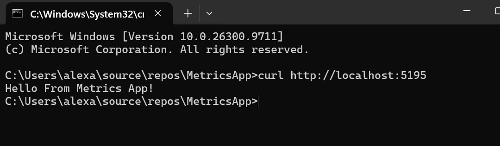
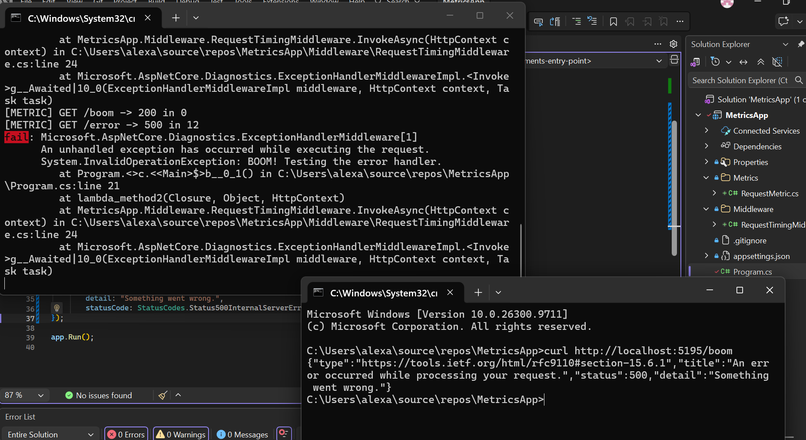
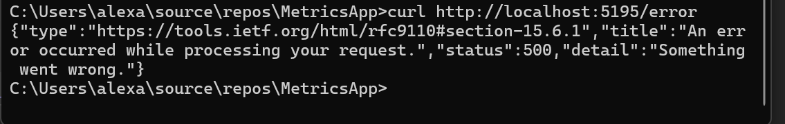
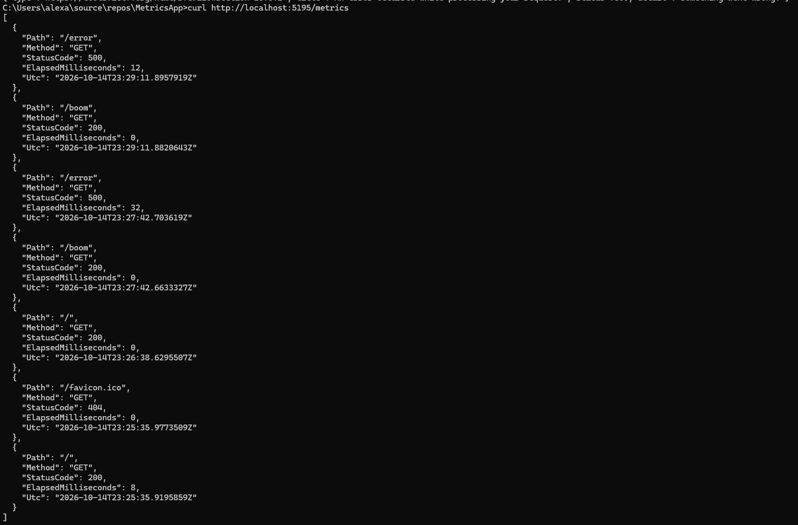

# MetricsApp

## Project Description

This ASP.NET coursework application demonstrating custom middleware, request timing middleware, recent metrics tracking, three endpoints, and global error handling.

## How to Run

1. Open the project in VS.
2. Run the application in CMD. Enter curl commands in second CMD window to test.
3.. Enter a curl command for `/boom` to test the error handler.
4. Enter a curl command for `/error` to view a custom error response.
5. Enter a curl command for `/metrics` to display RECENT request metrics.

## Screenshots

### Welcome

### Boom Test

### Error Test

### Metrics Test

